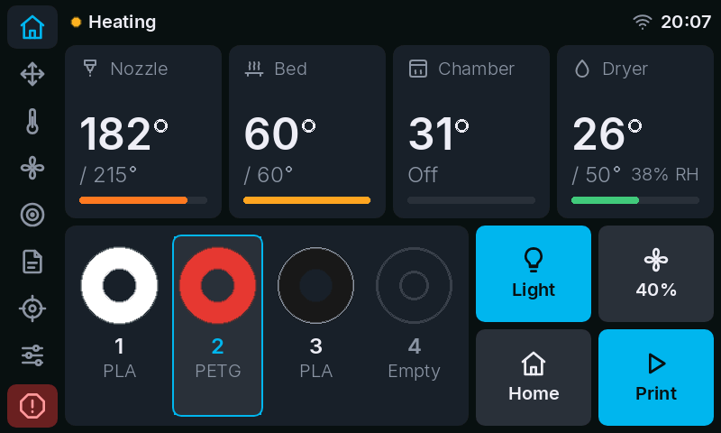
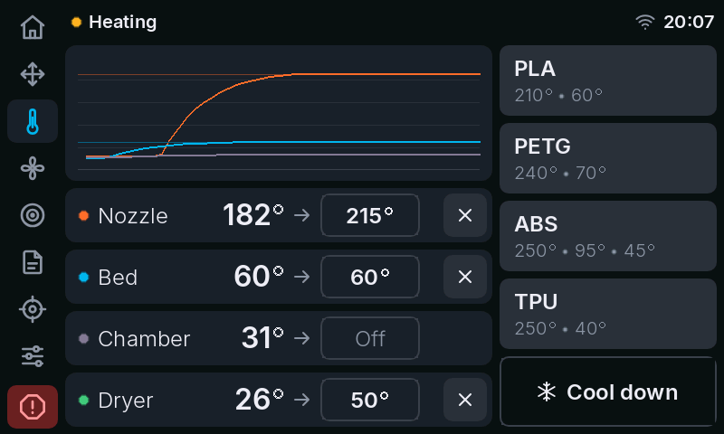
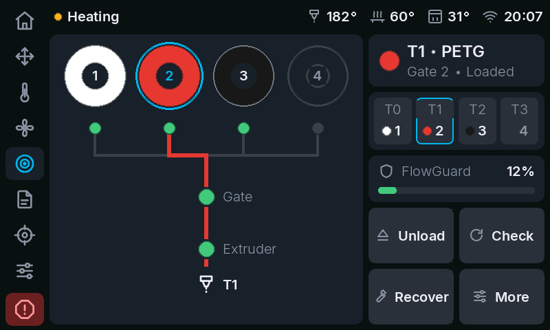
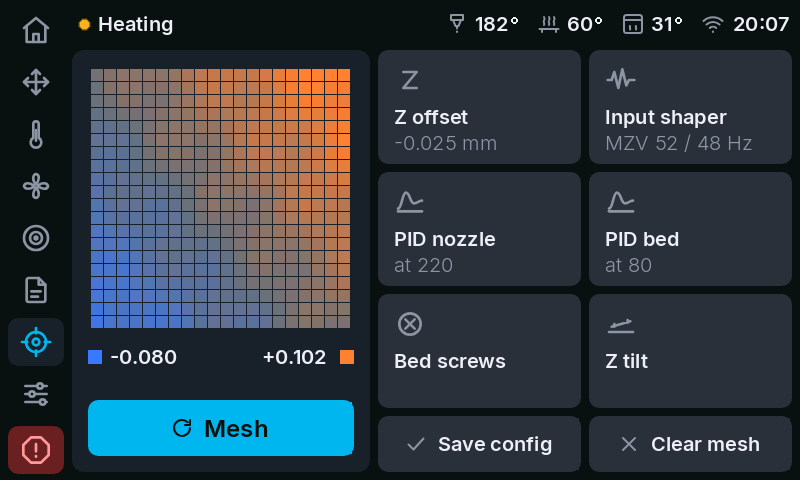
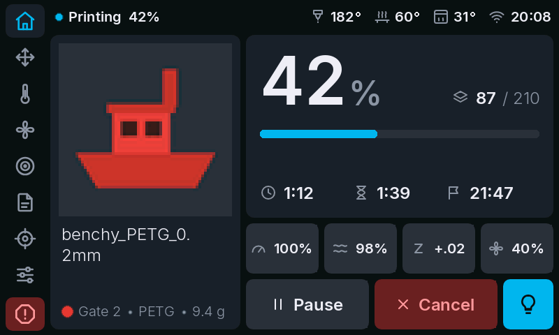
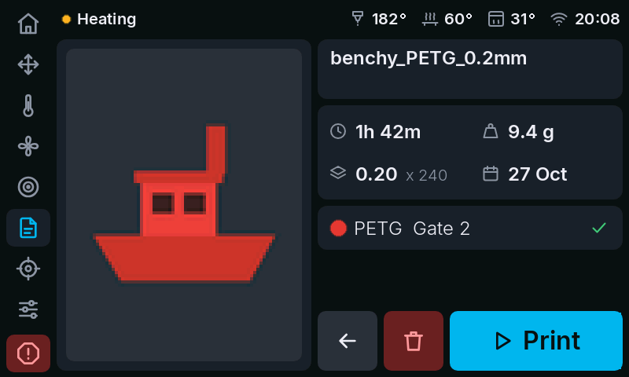

# klipmi-plus4

A touch UI for the **QIDI Plus 4** screen, drawn entirely from the printer's host by
[klipmi](https://github.com/frap129/klipmi). It replaces the stock and FreeDi screen software with one that
can do everything from the screen: temperatures, motion, fans, files, calibration (with a full-size bed mesh map),
Wi-Fi, and a Happy Hare MMU with dryer.

| | |
|---|---|
|  |  |
|  |  |
|  |  |

All 20 screenshots are in [docs/screens](docs/screens). They are rendered by `tools/preview.py` with the same
code that drives the real screen, colours reduced to the screen's RGB565.

> **Status:** first version. It runs on the author's printer, but parts are not yet tested on the
> real screen: the dryer controls, dragging sliders, the paper-test dialog during Z offset calibration and joining a
> Wi-Fi network. Issues and photos of the real screen are welcome.

## How it works
The screen (TJC8048X250_011, 800x480) gets its own minimal firmware, `hmi/plus4-canvas/plus4-canvas.tft`. It has one blank
page, the fonts and some picture sheets, but no buttons or logic. klipmi talks to Moonraker, draws every frame with TJC
serial commands (`fill`, `xstr`, `xpic`, ...) and redraws only what changed. The screen reports raw touch coordinates,
and the Python code decides what was pressed.
So almost every change (layout, pages, text, behaviour) is plain Python, and you don't need the screen editor for it.

- `src/klipmi/canvas/`: the drawing framework. `gfx.py` has the theme colours, fonts, icon and corner pictures and
  text measuring. `widgets.py` has buttons, sliders, toggles, bars and spools. `app.py` has the layout, navigation rail,
  status bar, dialogs and touch handling. `link.py` is the serial link at 921600 baud.
- `src/klipmi/ui/plus4canvas/`: the pages (`home`, `motion`, `box`, `files`, `calibrate`, `system`, `dialogs`).
- `hmi/plus4-canvas/`: the USART HMI project (`.HMI`), compiled firmware (`.tft`), generated fonts and pictures. Its
  [README](hmi/plus4-canvas/README.md) lists every font and picture id and how to rebuild.
- `tools/`: screenshot renderer, picture renderer, firmware flasher, serial benchmark.

## Requirements
- QIDI Plus 4 running Klipper and Moonraker, for example with [FreeDi](https://github.com/Phil1988/FreeDi).
  Any system that leaves `/dev/ttyS1` free for klipmi should work.
- Python 3.11 or newer on the printer.
- Optional: [Happy Hare](https://github.com/moggieuk/Happy-Hare). The Filament page and gate tiles only appear when
  Klipper has an `mmu` object.
- The temperature presets call the printer's `PRESET_MACRO_1..4` macros (FreeDi). The calibration buttons use
  `CALIBRATE_Z_OFFSET`, `INPUT_SHAPING_CALIBRATE`, `NOZZLE_PID_TUNE`, `BED_PID_TUNE`, `LEVEL_BED`, `Z_TILT_ADJUST` and
  `BED_MESH_CALIBRATE`. Adjust them in `src/klipmi/ui/plus4canvas/common.py` and `calibrate.py` if your macros differ.

## Install
On the printer (the user is `mks` on the stock image):
```bash
git clone https://github.com/carlosg-gh/klipmi-plus4.git ~/klipmi
cd ~/klipmi
python3 -m venv .venv
.venv/bin/pip install -r requirements.txt
```

1. **Stop whatever owns the screen.** With FreeDi: `sudo systemctl disable --now FreeDi.service`. That turns off the
   FreeDi screen service only; Klipper and the rest of FreeDi keep running.
2. **Flash the screen firmware.** This takes a minute, and the screen stays blank while it runs:
   ```bash
   .venv/bin/python tools/flash_tft.py --baud 115200 --upload-baud 921600 hmi/plus4-canvas/plus4-canvas.tft
   ```
   Use `--baud 921600` instead when the screen already runs this firmware, because it boots at 921600 baud.
3. **Configure.** Copy the example config with the command below, then open `~/printer_data/config/klipmi.toml` and
   uncomment the Plus 4 block, setting `ui = "plus4canvas"`:
   ```bash
   cp klipmi.toml.example ~/printer_data/config/klipmi.toml
   ```
4. **Run it.** Start klipmi by hand first:
   ```bash
   .venv/bin/python src/main.py
   ```
   Once it works, run `./install.sh`, which installs and starts `klipmi.service`.

**Going back to the stock screen:** flash QIDI's `xindi_800_480.tft` from
[QIDITECH/QIDI_PLUS4](https://github.com/QIDITECH/QIDI_PLUS4) (or FreeDi's screen firmware) with the same tool,
disable `klipmi.service` and re-enable the service you stopped.

## Modifying it
**Python only (most changes).** Edit the pages or widgets, then render screenshots without a printer:
```bash
pip install -r requirements.txt
PYTHONPATH=src python tools/preview.py out/ tests/fixtures/mmu-idle-bunnybox.json
```
The screenshots are written to `out/`. To draw on a real screen instead, run `tools/preview.py --device` on the printer.
Run the tests with `python -m unittest discover -s tests`.
Colours live in `Theme` and icons in `ICON_NAMES` (both in `src/klipmi/canvas/gfx.py`).
Changing a colour that an icon or corner sits on means the pictures have to be rebuilt (see below).

**Icons, colours or fonts (needs the screen editor).** Pictures have no transparency, so every icon sheet is baked
for one ink/background pair.
1. Icons are SVG paths in `tools/hmi_assets.js`. Run `node tools/hmi_assets.js` to rewrite
   `hmi/plus4-canvas/assets/pics/`. It needs Node and Chrome, no packages. Set `CHROME=/path/to/chrome` if Chrome
   is not in the Windows default location.
2. Open `hmi/plus4-canvas/plus4-canvas.HMI` in TJC's **USART HMI** editor. It runs on Windows only; get it from
   [tjc1688.com](http://www.tjc1688.com/). This project was built with version 1.68.2.
3. Replace the pictures in id order. Fonts are made with the editor's font tool from
   [Inter](https://github.com/rsms/inter). Both are listed in the [HMI README](hmi/plus4-canvas/README.md).
4. Compile, then use *File > output production file* to get the `.tft`, and flash it as in the Install section.

## Other UIs in this repo
Upstream klipmi's `openq1` UI (QIDI Q1 Pro, `hmi/openq1`) and an earlier `plus4` driver for QIDI's stock Plus 4 HMI
(`ui = "plus4"`, see `hmi/plus4/README.md`) are still included and selectable with `ui =` in the config.

## Credits
- **[klipmi](https://github.com/frap129/klipmi)** by Joe Maples ([@frap129](https://github.com/frap129)), with a
  contribution from Aidan Gibson. This project is a fork and keeps its history, serial and Moonraker layers, install
  script and service. Its dependencies [frap129/nextion](https://github.com/frap129/nextion) and
  [tjni/moonraker-api](https://github.com/tjni/moonraker-api) are used as they are.
- **[Inter](https://github.com/rsms/inter)** typeface by Rasmus Andersson and the Inter Project Authors, under the
  SIL Open Font License 1.1. The screen fonts in `hmi/plus4-canvas/fonts/` are generated from it. The licence is in
  [hmi/plus4-canvas/fonts/OFL.txt](hmi/plus4-canvas/fonts/OFL.txt).
- **TJC (Guangzhou Taojingchi)**: the screen and the USART HMI editor used to build the firmware.
- **[QIDI Tech](https://github.com/QIDITECH/QIDI_PLUS4)**: the Plus 4, and its AGPL-3.0 screen project. The `plus4`
  driver and the notes in `docs/` are based on it, but its files are not included here.
- **[FreeDi](https://github.com/Phil1988/FreeDi)** by Phil1988: the Klipper setup this was built on, and its
  temperature preset macros.
- **[Happy Hare](https://github.com/moggieuk/Happy-Hare)** by moggieuk: the MMU commands and status the Filament page
  uses.
- **[Klipper](https://github.com/Klipper3d/klipper)** and **[Moonraker](https://github.com/Arksine/moonraker)**.

The icons are original drawings for this project.

## License
GPL-3.0, as upstream klipmi ([LICENSE](LICENSE)). The generated fonts stay under the SIL Open Font License 1.1.
